# Dynamic Brain Connectivity Analysis in Alzheimer's Disease

[](https://www.python.org/)
[](docs/methodology.md)
[](https://scikit-learn.org/)
[](docs/research_proposal.md)

A Python toolkit for studying how functional connectivity in the brain changes over time in cognitively normal people (CN), people with mild cognitive impairment (MCI), and people with Alzheimer's disease (AD), using resting-state fMRI. It runs end to end on built-in synthetic data, and is set up to take real time series from an authorized dataset such as ADNI or OASIS-3 later.

> **Note:** every figure in this README comes from the built-in **synthetic (simulated) data**. The group differences were put into the simulator on purpose, so they only show that the code works. They are not findings about real patients, and no ADNI or OASIS-3 data are included.

## The idea

Brain regions that are active together at rest are said to be functionally connected. The usual way to measure this is one correlation matrix per scan (static connectivity), which assumes the connections stay the same for the whole recording.

Dynamic functional connectivity relaxes that. A short window slides along the recording, a correlation matrix is computed in each window, and the windows are clustered into a few recurring connectivity states. Then you can ask how much time someone spends in each state (occupancy), how long they stay (dwell time), and how often they switch. Two people can have similar average connectivity and still differ in how it moves between states.

This project compares CN, MCI and AD groups on static connectivity, on these state measures, and on network measures such as integration, segregation and modularity, and then checks how they relate to cognitive scores. Sliding-window results are easy to over-read, so the pipeline compares variability against a phase-randomised surrogate and repeats the analysis across window lengths, numbers of states, graph thresholds and motion cut-offs.

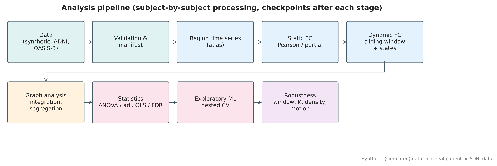

## Output

All figures below were generated by running the pipeline on the synthetic cohort (25 simulated subjects per group, 30 regions in 6 networks).

**Simulated regional BOLD time series** (one CN subject, coloured by network)

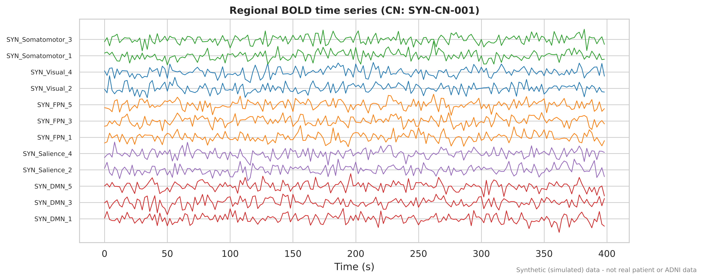

**Static functional connectivity**

Group-mean Pearson connectivity (Fisher z) on top, group differences below. In this simulated cohort, connectivity inside each network falls and connectivity between networks rises from CN to AD, which is how the simulator was set up.

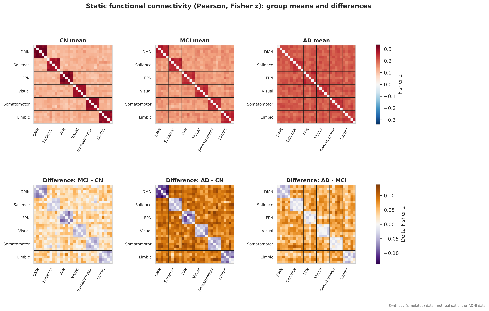

**Dynamic functional connectivity**

Mean connectivity in each sliding window for one example subject per group, coloured by the state the window was assigned to.

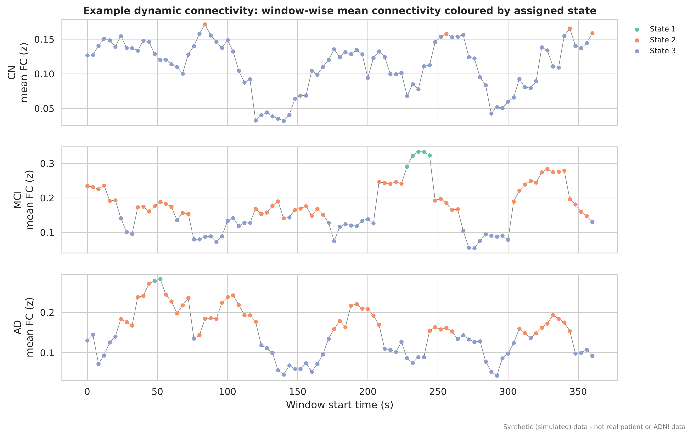

**Connectivity states**

The three k-means states, ordered by mean strength. State 1 is strongly connected everywhere; State 3 keeps strong within-network blocks but weak connections between networks.

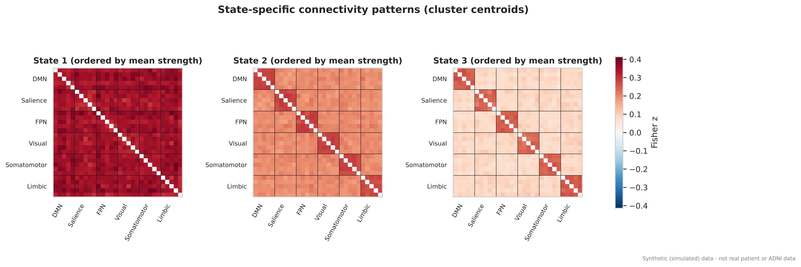

**State occupancy and dwell time**

Fraction of windows spent in each state, and mean time spent in a state before leaving it. In the simulated data the AD group spends more time in State 1 and less in State 3 than the CN group.

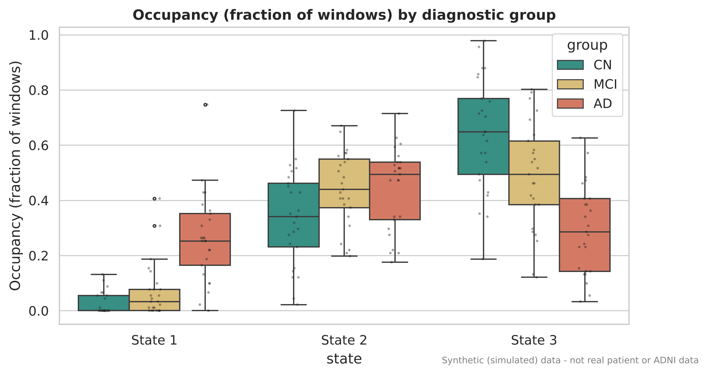

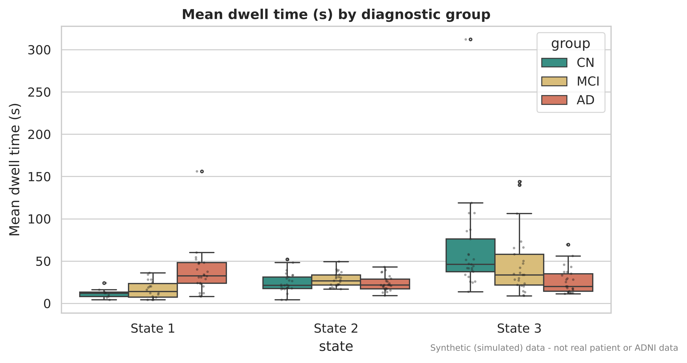

**Brain network analysis**

Graphs built from the strongest 25% of connections in each group's mean connectivity, with nodes coloured by network. More edges run between networks in the AD graph.

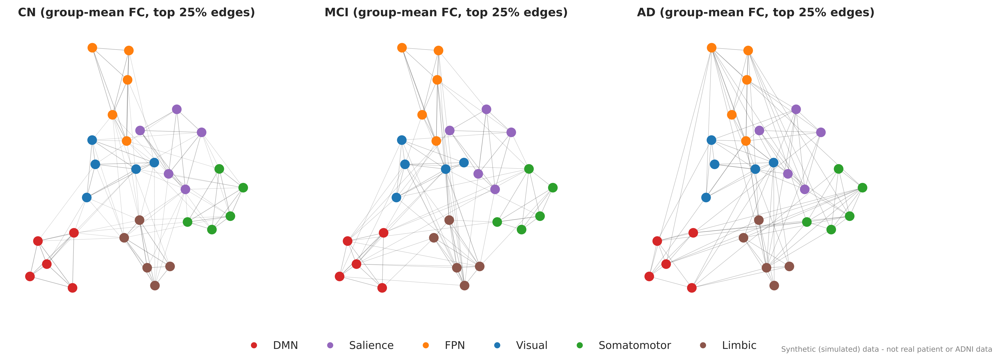

**Statistical analysis and group comparisons**

Per-subject graph metrics and dynamic metrics by group. The q-value under each panel is the covariate-adjusted, FDR-corrected group effect (age, sex, education, head motion and site are adjusted for).

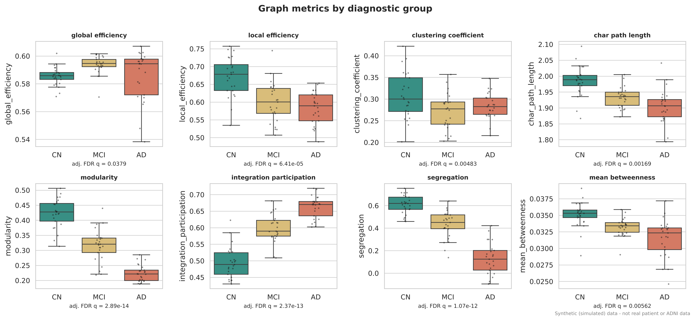

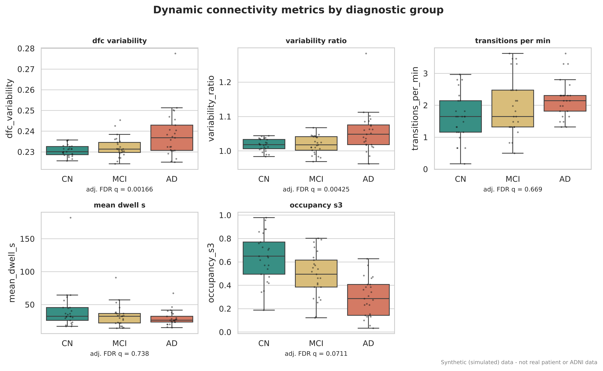

**Cognitive score associations**

Connectivity measures against MMSE and CDR-SB. The line is a pooled fit across all groups, so it mostly reflects differences between groups; the tables also report partial correlations that control for diagnostic group.

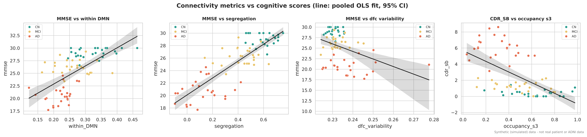

**Machine learning results**

Out-of-fold confusion matrices from nested cross-validation. The best configuration per task is picked after seeing the results, so these are optimistic; the full table with all models and permutation baselines is in `results/synthetic/tables/`.

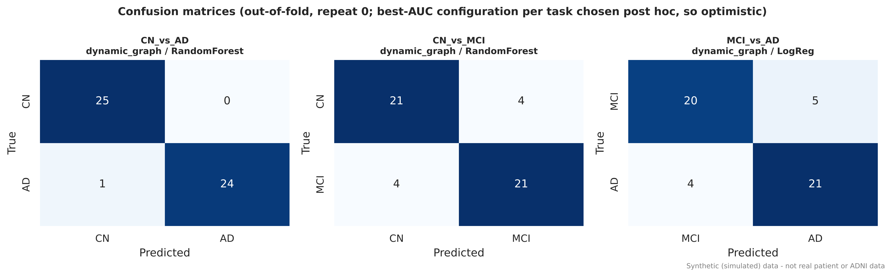

---

## What it does

- Generates synthetic region time series for CN, MCI and AD (state-switching connectivity, motion, demographics, MMSE / ADAS-Cog / CDR / CDR-SB) so the pipeline can be tested without any real data
- Validates inputs and writes a per-subject manifest with file hashes
- Static connectivity: Pearson and shrinkage partial correlation, within- and between-network summaries, regional tests
- Sliding-window dynamic connectivity with a phase-randomised surrogate for the variability
- Connectivity states with k-means (and GMM), plus occupancy, dwell time, transitions and transition matrices
- Graph metrics: global and local efficiency, clustering, path length, modularity, betweenness, participation, segregation
- Group comparisons (ANOVA or Kruskal-Wallis, covariate-adjusted models, post-hoc tests, effect sizes with CIs, FDR correction)
- Associations between connectivity and cognitive scores (Pearson, Spearman, partial correlation, regression)
- Exploratory classification (logistic regression, SVM, random forest, XGBoost if installed) with nested cross-validation and permutation baselines
- Robustness checks across window length, number of states, clustering seed, graph density, motion exclusion and subsampling
- Saves all figures (PNG and PDF), tables and an auto-generated report
- Works on a small laptop: one subject at a time, compressed intermediates, checkpoints, and a configurable data folder outside the repository

## Getting started

Needs Python 3.10 to 3.12. In the VS Code terminal (PowerShell on Windows):

```powershell
python -m venv .venv
.\.venv\Scripts\Activate.ps1
pip install -r requirements.txt
pip install -e .
python -m brain_connectivity.pipeline all
python -m pytest

On macOS / Linux use `source .venv/bin/activate` instead. The full pipeline takes roughly 5 to 8 minutes; results go to `results/synthetic/` (figures, tables, report). The synthetic cohort is already in `data/synthetic/`; regenerate it with `python scripts/generate_synthetic_data.py --force`. Step-by-step VS Code instructions and troubleshooting are in [docs/setup_guide.md](docs/setup_guide.md).

All parameters (window length, number of states, graph density, simulated effect sizes, ...) are in `config/config.yaml`.

## Data format

**Synthetic data** is the default and needs nothing from you.

**Real data** (not run yet, see Limitations) is expected as one regional time series per subject plus a participants table, stored outside the repository (set `DATA_ROOT` in `.env`, see `.env.example`):

```
DATA_ROOT/
  participants.csv
  derivatives/timeseries/<subject_id>.npz
```

Each `.npz` holds `ts` (time x regions, float32), `tr` (seconds), `region_labels` and `networks` (network name per region: DMN, Salience, FPN, Visual, Somatomotor, Limbic). `participants.csv` needs these columns:

| subject_id | group | age | sex | education | mean_fd | mmse | adas_cog | cdr | cdr_sb | site |
| ---------- | ----- | --- | --- | --------- | ------- | ---- | -------- | --- | ------ | ---- |
| S001       | CN    | 72  | F   | 16        | 0.12    | 29   | 8        | 0   | 0      | s1   |

`group` is CN, MCI or AD; the first six columns are required, the rest are optional (analyses that need a missing variable are skipped, not filled in). `scripts/extract_timeseries.py` builds the `.npz` files from already-preprocessed 4D images and an atlas (Schaefer-200 by default), and `scripts/prepare_participants.py` standardises ADNI or OASIS-3 clinical tables. All subjects in one run must share the same TR. Details: [docs/dataset_access.md](docs/dataset_access.md).

## Research context

Alzheimer's disease changes how brain regions talk to each other long before and alongside memory loss. Resting-state fMRI measures this without a task, and early studies found altered default mode network (DMN) connectivity in AD compared with healthy ageing. Later work looked at the whole network: how well regions integrate across networks, how segregated the networks are from one another, and how both change with age and disease. MCI is often treated as an intermediate stage, which is why this project compares three groups instead of two.

Most of that work uses one connectivity matrix per scan. Connectivity also fluctuates within a scan, and dynamic connectivity asks whether those fluctuations carry extra information about disease stage. Whether sliding-window states reflect real brain dynamics or mostly sampling noise is still debated, so this project treats them cautiously and tests them against a stationary surrogate. See [docs/literature_review.md](docs/literature_review.md) and [docs/methodology.md](docs/methodology.md).

## Limitations

- All results shown here use **synthetic data**. They show the pipeline works, not anything about Alzheimer's disease.
- The real-data code has only been tested on small artificial images, not on ADNI or OASIS-3. ADNI and OASIS-3 need an approved application and a data-use agreement.
- Sliding-window connectivity is sensitive to window length and noise. In the synthetic demo the states are only weakly separated and variability barely exceeds the surrogate; the robustness tables show this.
- Machine-learning scores are exploratory (small sample, single cohort, no external validation) and do not show clinical usefulness.
- The reference list in `docs/literature_review.md` still needs to be checked against the original papers.

More in [docs/limitations.md](docs/limitations.md).

## License

MIT, see [LICENSE](LICENSE). The copyright line currently reads "Project author"; replace it with your name before publishing.
